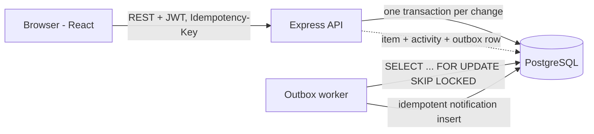

# Operations Under Pressure — Newtonite Software Engineering Challenge

An internal web app to **create, assign, track and resolve operational work items across teams**.
Work items move through a server-enforced workflow (Open → In Progress → Awaiting Approval → Resolved → Closed),
permissions are checked on the server per team and role, every change is recorded in an append-only activity log
(in the same DB transaction), and the dashboard is filtered, searchable and cursor-paginated on the server.

**Stack:** React + Vite (TypeScript) · Node.js + Express (TypeScript) · PostgreSQL 16 · Vitest + Supertest · Docker Compose

## Run it (one command)

Prerequisite: Docker Desktop (or Docker Engine + Compose v2).

```bash
git clone https://github.com/TejasxCoder/newtonite-ops.git
cd newtonite-ops
docker compose up --build
```

Open **http://localhost:3000**. On first start the app applies migrations and seeds 3 teams, 10 users and 3,000 items.

### Demo logins (password for all: `Passw0rd!`)

| Email | Role(s) |
|---|---|
| admin@ops.test | Admin in all 3 teams |
| priya.lead@ops.test | Lead in Payments Ops, Member in Customer Support |
| rahul.lead@ops.test | Lead in Customer Support |
| meera.lead@ops.test | Lead in Compliance |
| amit.member@ops.test | Member in Payments Ops + Customer Support |
| neha.member@ops.test | Member in Payments Ops |
| sara.member@ops.test | Member in Customer Support |
| dev.member@ops.test / zoya.member@ops.test | Member in Compliance |
| ravi.viewer@ops.test | Viewer in Payments Ops (read-only) |

Try: log in as `neha.member` and `amit.member` in two browsers and claim the same item; push an item to
*Awaiting Approval* and see that only a Lead (e.g. `priya.lead`) can approve it.

## Run the tests

Tests run against a real Postgres (a separate `ops_test` database is created automatically).

```bash
docker compose up -d db          # just the database
cd backend
npm install
npm test
```

## Local development (without Docker for the app)

```bash
docker compose up -d db
cd backend && npm install && npm run migrate && npm run seed && npm run dev     # API on :3000
cd frontend && npm install && npm run dev                                       # UI on :5173 (proxies /api)
```

Copy `.env.example` to `.env` if you want to override `DATABASE_URL`, `JWT_SECRET` or `PORT`.

## Architecture



The worker runs inside the API process (`RUN_WORKER=false` disables it) and can be split into its own process unchanged.

## API summary

| Method | Path | Notes |
|---|---|---|
| POST | /api/auth/login | returns JWT |
| GET | /api/me, /api/users | caller + team roles; users in my teams |
| GET | /api/items | `view=assigned_to_me\|unassigned_urgent\|awaiting_my_approval\|all`, `status`, `priority`, `type`, `teamId`, `assignee`, `q`, `cursor`, `limit` |
| POST | /api/items | create (supports `Idempotency-Key`) |
| GET / PATCH | /api/items/:id | PATCH needs the current `version` (409 + latest item on mismatch) |
| POST | /api/items/:id/claim | atomic; one winner, others 409 |
| POST | /api/items/:id/transition | `{ "to": "..." }` — server-enforced workflow |
| POST | /api/items/:id/comments | appended to the activity log |
| GET | /api/items/:id/activity | cursor-paginated history |

## Roles and permissions (enforced in `backend/src/permissions.ts`)

| Action | Viewer | Member | Lead | Admin |
|---|:-:|:-:|:-:|:-:|
| Read items / history | ✅ | ✅ | ✅ | ✅ |
| Create, edit, comment, claim, move through *Open → In Progress → Awaiting Approval* | ❌ | ✅ | ✅ | ✅ |
| Assign / reassign others | ❌ | ❌ | ✅ | ✅ |
| Approve (*Awaiting Approval → Resolved*), reject, close, reopen | ❌ | ❌ | ✅ | ✅ |

Roles are **per team**: a Lead in Payments is just a Member (or nothing) in other teams.

## Critical behaviours implemented (each has a test in `backend/tests/critical.test.ts`)

1. **Concurrent claim** — conditional `UPDATE ... WHERE assignee_id IS NULL`; exactly one wins, the rest get 409.
2. **Stale-update handling** — optimistic locking on `version`; mismatch → 409 with the latest item.
3. **Idempotency** — `Idempotency-Key` stored in the same transaction; duplicates (even parallel) replay one stored response.
4. **Workflow rules** — allowed-transition map + role per transition; invalid jumps → 422, non-Lead approval → 403.
5. **Resource-level authorization** — one `assertCan()` used by every endpoint, scoped to the item's team.
6. **Reliable async work** — transactional outbox, worker with retries/backoff, max attempts, idempotent handler.
7. **Optimistic UI reconciliation** — claim/transition update the UI instantly and roll back with the server's reason on 409/403.

## Known limitations

- Seeded users only (no sign-up, password reset or token refresh); JWT lives in `localStorage`.
- Notifications are rows in a `notifications` table — no email/push delivery (out of scope per brief).
- Search uses Postgres full-text on title + description (English stemming); no fuzzy matching or per-field ranking.
- Dashboard refreshes by polling every 30 s; no websockets.
- Comments are stored as `comment` events in the activity log (single timeline) rather than a separate table.
- Idempotency keys are never purged (a TTL cleanup job would be added) and are only stored for successful requests.
- Anyone with the Member role can move an item to *Awaiting Approval*, not only the assignee.
- No frontend automated tests; the optimistic rollback was verified manually.
- Items are never deleted (closed is terminal).

## Next week I would…

Add a TTL cleanup job for idempotency keys and old jobs, per-team workflow configuration, Playwright tests for the
optimistic rollback, assignee-only transitions, SLA/due-date escalation jobs, and a proper refresh-token flow.
